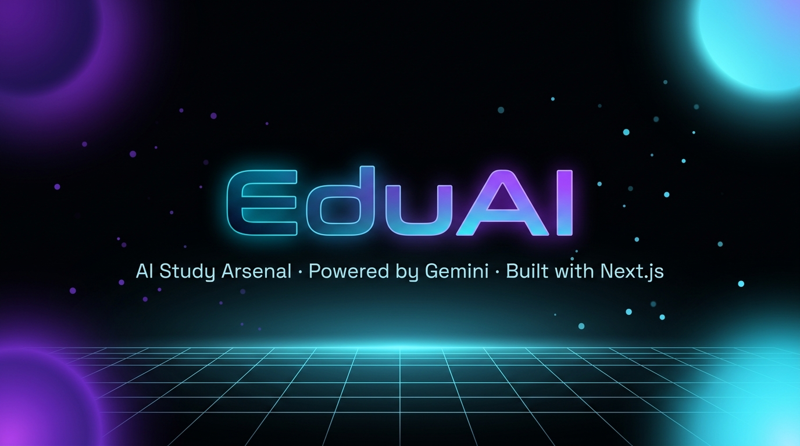

<div align="center">



# ⚡ EduAI — AI Study Arsenal

**Next-generation AI tools for students, powered by Google Gemini**

[](https://nextjs.org/)
[](https://react.dev/)
[](https://www.typescriptlang.org/)
[](https://tailwindcss.com/)
[](https://supabase.com/)
[](https://clerk.com/)
[](https://ai.google.dev/)
[](https://razorpay.com/)
[](https://web.dev/progressive-web-apps/)

[🚀 Live Demo](https://eduai.vercel.app) · [📖 Docs](#-api-reference) · [🐛 Report Bug](https://github.com/Shashwat9557322620/eduai-platform/issues) · [✨ Request Feature](https://github.com/Shashwat9557322620/eduai-platform/issues)

</div>

---

## 📖 Table of Contents

- [About](#-about)
- [Core Features](#-core-features)
- [Tech Stack](#-tech-stack)
- [Project Structure](#-project-structure)
- [Getting Started](#-getting-started)
- [Environment Variables](#-environment-variables)
- [API Reference](#-api-reference)
- [Database Schema](#-database-schema)
- [Credit & Payment System](#-credit--payment-system)
- [Security](#-security)
- [Testing](#-testing)
- [Deployment](#-deployment)
- [Contributing](#-contributing)

---

## 🎯 About

**EduAI** is a production-grade, AI-powered EdTech platform built for Indian students preparing for IIT, NEET, UPSC, GATE, university exams, and career transitions.

It combines **Google Gemini 2.5 Flash Lite**, a **freemium credit system**, **Razorpay payments**, and a cinematic UI built with **Three.js WebGL**, **Framer Motion**, and **50+ CSS keyframe animations** into a single, cohesive product.

> **"The AI study companion that actually understands your curriculum."**

---

## ✨ Core Features

### 🧠 AI-Powered Study Tools

| Tool | Description |
|------|-------------|
| **📅 Curriculum Optimizer** | Paste any syllabus + target days → Gemini generates a personalized, day-by-day study plan |
| **🃏 Neural Flashcards** | Paste raw notes or text → AI generates front/back flashcards with 3D flip animation |
| **🔍 Skill Gap Analyzer** | Input current skills + target job role → AI outputs a full markdown skill gap analysis |
| **🎙️ AI Podcast** | Convert study material into audio-format podcast content |
| **🤖 AI Tutor** | Conversational AI tutor for on-demand explanations |

### 💳 Freemium Credit System

- **Guest users** — limited daily uses via `localStorage` (2 optimizer / 3 flashcards / 2 analyzer)
- **Free accounts** — 5 optimizer / 10 flashcards / 5 analyzer per day
- **Paid plans** — buy credit packs; each AI tool use costs 1 credit

### 🏢 Platform Features

- **Affiliate System** — referral tracking, affiliate dashboard, commission management
- **Admin Panel** — full dashboard with refund management, support ticket system, intrusion logs
- **Billing Dashboard** — full payment history, invoice tracking, plan upgrades
- **Support System** — ticket creation, real-time tracking, admin responses via email
- **Refund System** — request, track, and resolve refunds with admin workflow
- **Institutes Page** — B2B landing for educational institutions
- **PWA Support** — installable on mobile and desktop with service worker caching
- **Google Analytics** — integrated via `gtag.js`

### 🎨 Visual & UX Excellence

- **Three.js WebGL** — wireframe icosahedron, DNA double helix, molecular structures, orbital electron shells, gravity grid GLSL shader, 2,500-particle system
- **Framer Motion** — page transitions, scroll-triggered reveals, stagger animations
- **Lenis Smooth Scroll** — buttery 60fps scroll physics
- **Cinematic CSS** — 50+ keyframe animations (holo-shimmer, plasma-flow, quantum-float, glitch, etc.)
- **Glassmorphism** — frosted glass cards, gradient borders, backdrop blur
- **Custom Cursor System** — magnetic cursor with trail effects
- **Onboarding Tour** — first-visit guided walkthrough
- **Reduced Motion** — full `prefers-reduced-motion` support across all animations

---

## 🛠 Tech Stack

| Category | Technology |
|----------|-----------|
| **Framework** | Next.js 16.2.6 (App Router) |
| **Runtime** | React 19, TypeScript 5 |
| **Styling** | Tailwind CSS v4 + 50+ custom CSS animations |
| **Authentication** | Clerk (`@clerk/nextjs` v7) |
| **Database** | Supabase (PostgreSQL via REST) |
| **AI Engine** | Google Gemini 2.5 Flash Lite (`@google/generative-ai`) |
| **Payments** | Razorpay (Orders API + Webhooks) |
| **3D / WebGL** | Three.js + `@react-three/fiber` + `@react-three/drei` |
| **Animations** | Framer Motion 12 + Lenis smooth scroll |
| **Email** | Nodemailer + Resend |
| **Validation** | Zod v4 |
| **State** | TanStack React Query v5 |
| **Math Rendering** | KaTeX + `remark-math` + `rehype-katex` |
| **Icons** | Lucide React |
| **Charts** | Recharts |
| **Testing** | Vitest + Playwright (E2E) + Testing Library |
| **Linting** | ESLint 9 |

---

## 📁 Project Structure

```
eduai-platform/
├── app/
│   ├── page.tsx                  # Landing page (cinematic hero)
│   ├── optimizer/                # Curriculum Optimizer
│   ├── flashcards/               # Neural Flashcard Generator
│   ├── analyzer/                 # Skill Gap Analyzer
│   ├── tutor/                    # AI Tutor
│   ├── podcast/                  # AI Podcast Generator
│   ├── billing/                  # Plans & Payment
│   ├── dashboard/                # User Dashboard
│   │   ├── affiliate/            # Affiliate Dashboard
│   │   └── settings/             # User Settings
│   ├── admin/                    # Admin Panel (protected)
│   ├── affiliate/                # Affiliate Landing
│   ├── institutes/               # B2B Institutes
│   ├── blog/                     # Blog + [slug]
│   ├── support/                  # Support Tickets
│   ├── sign-in/[[...rest]]/      # Clerk Sign In
│   ├── sign-up/[[...rest]]/      # Clerk Sign Up
│   │
│   ├── api/
│   │   ├── generate/             # POST — Curriculum Optimizer (Gemini)
│   │   ├── flashcards/           # POST — Flashcard Generator (Gemini)
│   │   ├── analyzer/             # POST — Skill Gap Analyzer (Gemini)
│   │   ├── tutor/                # POST — AI Tutor (Gemini)
│   │   ├── podcast/              # POST — AI Podcast (Gemini)
│   │   ├── checkout/             # POST — Create Razorpay Order
│   │   ├── verify-payment/       # POST — Verify Razorpay Payment
│   │   ├── webhook/razorpay/     # POST — Razorpay Webhook (HMAC)
│   │   ├── affiliate/            # GET/POST — Affiliate Management
│   │   ├── referral/             # POST — Referral Tracking
│   │   ├── support/              # POST — Create Support Ticket
│   │   ├── refund/               # POST — Submit Refund Request
│   │   ├── user/credits/         # GET — Credit Balance
│   │   ├── history/              # GET — Usage History
│   │   ├── admin/                # Admin APIs
│   │   ├── feedback/             # POST — User Feedback
│   │   ├── newsletter/           # POST — Newsletter Subscribe
│   │   └── health/               # GET — Health Check
│   │
│   └── components/
│       ├── landing/              # Hero section
│       ├── three/                # Three.js WebGL components
│       ├── ui/                   # Reusable UI primitives
│       ├── Navbar.tsx
│       ├── CursorSystem.tsx
│       ├── CreditWarningBanner.tsx
│       ├── SettingsModal.tsx
│       └── ReferralCard.tsx
│
├── lib/
│   ├── credits.ts                # Credit deduction logic
│   ├── tokenBillingEngine.ts     # Token-based billing
│   ├── usageLimits.ts            # Free tier rate limiting
│   ├── validation.ts             # Zod schemas
│   ├── monitoring.ts             # Error & performance monitoring
│   └── logger.ts                 # Structured logging
│
├── public/                       # Static assets + PWA manifest
├── tests/                        # Vitest unit tests
├── __tests__/                    # Component tests
├── .env.example                  # Environment variable template
└── next.config.ts
```

---

## 🚀 Getting Started

### Prerequisites

- **Node.js** >= 18.17
- **npm** >= 9
- A [Supabase](https://supabase.com) project
- A [Clerk](https://clerk.com) application
- A [Google AI Studio](https://aistudio.google.com) API key (Gemini)
- A [Razorpay](https://razorpay.com) account

### 1. Clone the repository

```bash
git clone https://github.com/Shashwat9557322620/eduai-platform.git
cd eduai-platform
```

### 2. Install dependencies

```bash
npm install
```

### 3. Configure environment variables

```bash
cp .env.example .env.local
```

Fill in all values — see [Environment Variables](#-environment-variables) below.

### 4. Set up the database

Run the SQL scripts in your Supabase SQL Editor. Use the files from the `scripts/` directory (kept locally, never committed).

### 5. Start the development server

```bash
npm run dev
```

Open [http://localhost:3000](http://localhost:3000) 🎉

---

## 🔑 Environment Variables

```env
# Clerk Authentication
NEXT_PUBLIC_CLERK_PUBLISHABLE_KEY=pk_test_...
CLERK_SECRET_KEY=sk_test_...
CLERK_WEBHOOK_SECRET=whsec_...
NEXT_PUBLIC_CLERK_SIGN_IN_URL=/sign-in
NEXT_PUBLIC_CLERK_SIGN_UP_URL=/sign-up

# Supabase
NEXT_PUBLIC_SUPABASE_URL=https://xxxx.supabase.co
NEXT_PUBLIC_SUPABASE_ANON_KEY=eyJ...
SUPABASE_SERVICE_ROLE_KEY=eyJ...

# Google Gemini AI
GEMINI_API_KEY=AIza...

# Razorpay
RAZORPAY_KEY_ID=rzp_test_...
RAZORPAY_KEY_SECRET=...
RAZORPAY_WEBHOOK_SECRET=...
NEXT_PUBLIC_RAZORPAY_KEY_ID=rzp_test_...

# Email (SMTP)
SMTP_HOST=smtp.gmail.com
SMTP_PORT=587
SMTP_SECURE=false
SMTP_USER=your@email.com
SMTP_PASS=your_app_password

# Admin
ADMIN_PASSWORD=your_secure_admin_password
NEXT_PUBLIC_ADMIN_USER_ID=user_...

# Resend
RESEND_API_KEY=re_...

# App
NEXT_PUBLIC_APP_URL=http://localhost:3000
```

> ⚠️ **Never commit `.env.local`** — it is git-ignored by default. A full template is in [`.env.example`](.env.example).

---

## 📡 API Reference

### AI Tools

| Method | Endpoint | Description |
|--------|----------|-------------|
| `POST` | `/api/generate` | Curriculum Optimizer — study plan via Gemini |
| `POST` | `/api/flashcards` | Flashcard Generator — Q&A pairs via Gemini |
| `POST` | `/api/analyzer` | Skill Gap Analyzer — career gap analysis via Gemini |
| `POST` | `/api/tutor` | AI Tutor — conversational explanations |
| `POST` | `/api/podcast` | AI Podcast — study content to audio format |

### Payments

| Method | Endpoint | Description |
|--------|----------|-------------|
| `POST` | `/api/checkout` | Create Razorpay order (server-validates plan & price) |
| `POST` | `/api/verify-payment` | Verify payment signature after Razorpay callback |
| `POST` | `/api/webhook/razorpay` | Razorpay webhook — HMAC SHA-256 verified, adds credits |

### User & Platform

| Method | Endpoint | Description |
|--------|----------|-------------|
| `GET` | `/api/user/credits` | Credit balance and plan name |
| `GET` | `/api/history` | Usage history |
| `POST` | `/api/support` | Create a support ticket |
| `POST` | `/api/refund` | Submit a refund request |
| `GET/POST` | `/api/affiliate` | Affiliate registration and lookup |
| `GET` | `/api/affiliate/dashboard` | Affiliate earnings dashboard |
| `POST` | `/api/referral` | Track referral conversions |
| `GET` | `/api/health` | Health check |

---

## 🗄 Database Schema

```sql
user_credits     (user_id, credits, plan_name, updated_at)
user_history     (id, user_id, tool_name, input_summary, credits_used, created_at)
payments         (id, order_id, payment_id, user_id, amount, status, plan_name, created_at)
support_tickets  (id, tracking_id, user_id, subject, message, status, admin_response, created_at)
refund_requests  (id, user_id, order_id, reason, amount, status, created_at)
affiliates       (id, user_id, referral_code, total_referrals, earnings, created_at)
intrusion_log    (id, user_id, event_type, ip_address, details, created_at)
```

---

## 💳 Credit & Payment System

### Plans (Server-Side Validated)

| Plan | Credits | Price |
|------|---------|-------|
| 🟢 Starter Core | 150 credits | ₹199 |
| 🔵 Scholar Protocol | 500 credits | ₹499 |
| 🟣 Apex Overlord | 99,999 credits | ₹999 |

### Payment Flow

```
Client → POST /api/checkout { planId }
       ← Server validates against ALLOWED_PLANS, creates Razorpay order
       → User completes payment on Razorpay
Razorpay → POST /api/webhook/razorpay
         → Server verifies HMAC SHA-256 (timingSafeEqual)
         → Credits added to user_credits table
```

> Plan prices are **defined server-side only** — the client cannot tamper with the amount.

---

## 🔐 Security

| Layer | Implementation |
|-------|---------------|
| **Authentication** | Clerk — JWT-based, edge-compatible |
| **Authorization** | `currentUser()` checked on every protected API |
| **Admin Auth** | Custom `ADMIN_PASSWORD` via Bearer token |
| **Payment Integrity** | Razorpay HMAC SHA-256 + `timingSafeEqual()` |
| **Price Tampering** | Plans validated server-side against `ALLOWED_PLANS` constant |
| **Input Validation** | Zod schemas on all API request bodies |
| **Intrusion Logging** | Suspicious events logged to `intrusion_log` table |
| **Rate Limiting** | Per-user daily limits enforced server-side |

---

## 🧪 Testing

```bash
# Unit tests
npm test

# Watch mode
npm run test:watch

# Coverage report
npm run test:coverage

# E2E tests (Playwright)
npm run test:e2e

# E2E with UI
npm run test:e2e:ui
```

---

## 🚢 Deployment

### Vercel (Recommended)

1. Push to GitHub
2. Import repo at [vercel.com/new](https://vercel.com/new)
3. Add all environment variables from `.env.example`
4. Deploy — Vercel auto-detects Next.js ✅

### Manual Build

```bash
npm run build
npm start
```

### Bundle Analysis

```bash
npm run analyze
```

---

## 🤝 Contributing

1. Fork the repo
2. Create a feature branch: `git checkout -b feat/your-feature`
3. Commit your changes: `git commit -m 'feat: add amazing feature'`
4. Push to the branch: `git push origin feat/your-feature`
5. Open a Pull Request

**Please ensure:**
- Tests pass: `npm test`
- No secrets or `.env.local` committed
- TypeScript types are correct

---

## 📄 License

Private & Proprietary. All rights reserved © 2025 EduAI.

---

<div align="center">

Built with ❤️ by **Shashwat** | [GitHub](https://github.com/Shashwat9557322620)

*Empowering every student with AI — one study session at a time.*

</div>
